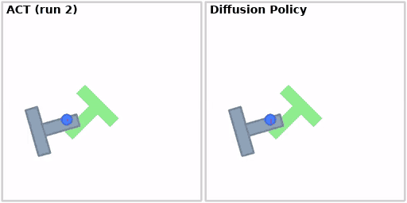
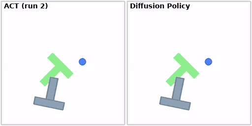
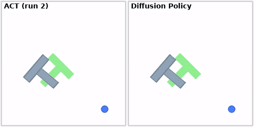
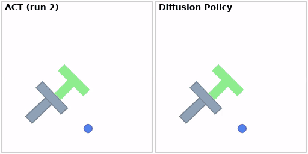
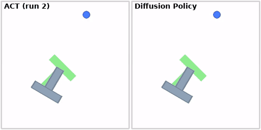

# PushT imitation learning benchmark: ACT vs Diffusion Policy

I trained ACT policies on LeRobot's PushT dataset and compared them with the pretrained Diffusion Policy on 50 identical simulator seeds. The best ACT run reached **14%** success against **58%** for Diffusion Policy. Most of the repo is about why, and about how much a single evaluation number can be trusted.

**Stack:** LeRobot 0.6.1 · PyTorch · Weights & Biases · gym-pusht · Google Colab (T4)
**W&B:** [project](https://wandb.ai/rochans-org/lerobot-pusht-benchmark) · [ACT run 2](https://wandb.ai/rochans-org/lerobot-pusht-benchmark/runs/2v7lax9i) · [ACT run 1](https://wandb.ai/rochans-org/lerobot-pusht-benchmark/runs/z72m3mq5)
**Notebook:** [`pusht_act_vs_diffusion.ipynb`](pusht_act_vs_diffusion.ipynb) [](https://colab.research.google.com/github/Dyresty/imitation-learning-benchmark/blob/main/pusht_act_vs_diffusion.ipynb)

## Goal

Measure how a policy I trained myself (ACT) compares with a strong public baseline (Diffusion Policy) on the same task, using one fixed evaluation protocol rather than a single headline number, and understand the gap.

## Setup

| | |
|---|---|
| Task | PushT: push a T-shaped block onto a target pose in 2D (`gym-pusht`). Observation: 96x96 RGB image + 2D agent position. Max 300 steps per episode. |
| Data | `lerobot/pusht`: 206 human demonstrations, 25,650 frames |
| Baseline | `lerobot/diffusion_pusht`, pretrained by the LeRobot team (not retrained) |
| Evaluation | 50 episodes per policy, seeds 100000-100049, so every policy starts from identical initial states. Success = T covers at least 95% of the target. "Max reward" is the best coverage-based reward reached in an episode (1.0 = success). |
| Hardware | Google Colab, NVIDIA T4 |

ACT settings (everything else is the LeRobot default: ResNet-18 backbone, CVAE objective, learning rate 1e-5):

| | Run 1 | Run 2 |
|---|---|---|
| Actions predicted per step (chunk size) | 100 | 20 |
| Actions executed before re-predicting | 100 | 10 |
| Batch size | 8 | 32 |
| Training steps | 25k (about 8 passes over the data) | 20k (about 25 passes) |
| Training speed on T4 | about 10 steps/s | about 6 steps/s (54 min total) |

## Results

Seeds 100000-100049, 50 episodes per policy ([`results/results.md`](results/results.md), per-seed numbers in [`results/per_seed.csv`](results/per_seed.csv)):

| Policy | Success | 95% CI (Wilson) | Avg max reward |
|---|---|---|---|
| Diffusion Policy (pretrained) | 29/50 = **58%** | 44-71% | 0.933 |
| ACT run 2 (chunk 20, batch 32, 20k steps) | 7/50 = **14%** | 7-26% | 0.763 |
| ACT run 1 (defaults)* | 0/50 = 0% | 0-7% | 0.434 |
| ACT run 1 + temporal ensembling*, inference-time only | 1/50 = 2% | 0-10% | 0.339 |

\* Run 1's checkpoint and evaluation files were lost when the Colab session reset, so these two rows are copied from the evaluation logs of the same protocol and seeds. They have no per-episode files or videos.

**Paired comparison on identical seeds (exact McNemar test), ACT run 2 vs Diffusion:** both succeed on 6 seeds, neither on 20, Diffusion only on 23, ACT only on 1 (p < 0.001).

**Training progress, ACT run 2** (10 evaluation episodes at each checkpoint, so noisy):

| Step | Successes | Avg max reward |
|---|---|---|
| 5k | 0/10 | 0.45 |
| 10k | 1/10 | 0.58 |
| 15k | 3/10 | 0.77 |
| 20k | 2/10 | 0.83 |

Average max reward rose at every checkpoint, while the success count moved around. The final 50-episode evaluation gave 14%.

## Failure analysis

Side by side, ACT run 2 (left) and Diffusion Policy (right), same seed. The pusher is the blue dot with the red cross, the green T is the target. Each GIF shows the full episode; an episode that ends early (success) holds its last frame.

**Failure patterns**

| | Failures | Within 10% of success (max reward >= 0.9) | Partial (0.5-0.9) | Never got going (< 0.5) |
|---|---|---|---|---|
| ACT run 2 | 43 | 21 | 9 | 13 |
| Diffusion Policy | 21 | 13 | 6 | 2 |

Both policies fail mostly by stopping just short of the strict 95% threshold. ACT additionally has a group of episodes (13 of 43) where it never gets the T near the target, which Diffusion rarely does (2 of 21 failures).

**Seed 100006: near-miss for both** (ACT max reward 0.997, Diffusion 0.998)

ACT puts the T almost exactly on the target by about 15 s and hovers there without the last small correction; in the final seconds it knocks the T out of alignment. Diffusion settles a few pixels off the target and stays there.

**Seed 100005: partial for both** (ACT 0.453, Diffusion 0.693)

ACT gets the T near the target at the wrong angle, then pushes it against the top edge of the arena, where it stays stuck for the last ~12 s. Diffusion approaches the target and then drifts away to the lower left.

**Seed 100008: Diffusion stalls** (ACT 0.986, Diffusion 0.270)

Diffusion parks the pusher on one end of the T for about 16 s without moving it to the target, then drifts away. ACT gets this one almost aligned (a near-miss).

**Successes**

**Seed 100002: ACT succeeds in about 13 s, Diffusion misses by a hair** (ACT 1.000, Diffusion 0.995)

Diffusion has the T almost aligned early on, then keeps adjusting for the full 30 s without crossing the threshold.

**Seed 100004: both succeed** (ACT in 289 of 300 steps, Diffusion in 176)

ACT first pushes the T far to the lower left and then recovers; it finishes just before the step limit. Diffusion takes a more direct path.

The descriptions are from watching the rollouts (full-quality videos in [`media/videos/`](media/videos/)); the failure lists for every episode are in [`results/failures.md`](results/failures.md).

## What I learned

- **A single number hides a lot.** Success rate on 50 episodes has a wide confidence interval (14% is 7-26%), and the 10-episode checks during training swung between 0% and 30% while the underlying reward steadily rose. Average max reward and the near-miss counts were more informative than success rate alone.
- **Evaluation was reproducible.** Re-running the Diffusion evaluation in a fresh session gave identical numbers (29/50, 0.933), so differences between policies come from the policies, not the simulator.
- **Training configuration mattered more than inference tricks.** Temporal ensembling on the run-1 checkpoint did not help (2% vs 0%). Changing the chunking and training budget in run 2 took ACT from 0% to 14%. Several settings changed together, so I cannot say which one did it.
- **ACT's latent variable collapsed** in run 2 (`kld_loss` fell to about 0.001), meaning the model barely uses it. PushT has many valid ways to push the T, so I suspect this hurts, but I have not tested it.
- **Both policies lack a clean "finish".** Many failures hover within a few percent of the threshold, and on seed 100002 Diffusion keeps adjusting for the full episode without crossing it.

## Next steps

- Retrain ACT with a lower `kl_weight`, more steps, and compare, to test the collapsed-latent suspicion on its own.
- Evaluate on more seeds (for example 200) to tighten the confidence intervals.
- Fine-tune a vision-language-action model (SmolVLA with LoRA) on a LeRobot simulation task and evaluate it with this same protocol.

## Reproduce

1. Open the notebook in Colab with a GPU runtime, add your `WANDB_API_KEY` to Colab Secrets.
2. Run the sections in order. Checkpoints and evaluation outputs are copied to Google Drive.
3. The comparison script works on any `lerobot-eval` outputs:
   `python scripts/compare_results.py --run "ACT=outputs/eval/act" --run "Diffusion=outputs/eval/diffusion" --start-seed 100000`

## Repo layout

```
pusht_act_vs_diffusion.ipynb   training and evaluation notebook
scripts/compare_results.py     success rates, Wilson CIs, McNemar test, per-seed CSV, failure list
results/                       results.md, per_seed.csv, failures.md
media/                         side-by-side GIFs; media/videos has the full-quality rollouts
```

## Acknowledgements

Built on [LeRobot](https://github.com/huggingface/lerobot) (Apache-2.0). Baseline checkpoint `lerobot/diffusion_pusht` by the LeRobot team. ACT: Zhao et al., 2023. Diffusion Policy: Chi et al., 2023.
